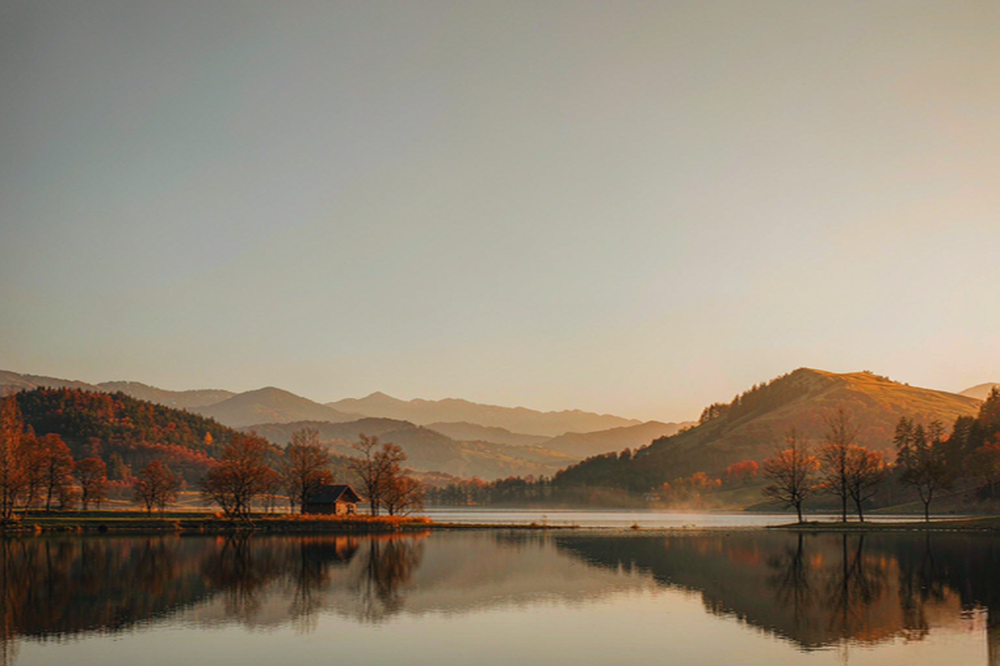

# 四季动态循环壁纸 · Seasons Wallpaper Studio

> 同一山谷湖畔场景，构图 / 建筑 / 山体轮廓全程不变，四季自由切换；
> 阳光角度、雾气浓度、风力强弱、飘落速度全部可调；循环无缝，桌面图标区始终留白干净。



---

## 核心特性

| 能力 | 说明 |
|---|---|
| **四季切换** | 春 / 夏 / 秋 / 冬，母版图由同一张参考图图生图派生，构图分毫不动 |
| **构图恒定** | 山体轮廓、小屋位置、树木分布、水岸线在四季之间完全一致 |
| **可调参数** | 阳光角度 0–360°、雾气浓度、风力强弱、飘落速度、镜头呼吸幅度、循环时长 |
| **无缝循环** | 所有动效都是循环相位 `phase∈[0,1)` 的周期函数，第 0 帧与第 1 帧严格一致 |
| **写实质感** | AI 生成 8K 写实母版 + 实时雾气/光束/波光/飘落叠加层 + 电影级调色 |
| **图标安全区** | 上方 42% 与中部保持干净，飘落粒子与雾气不侵入 |
| **5 个场景** | 山谷湖畔 / 林间小路 / 中式庭院 / 海边 / 森林 |
| **5 种画风** | 治愈写实 / 新海诚 / 宫崎骏 / 水墨国风 / 极简写实 |
| **多种比例** | 16:9 电脑、9:16 手机、21:9、1:1、4:3 |
| **零外部依赖** | 纯前端 Canvas 2D，无第三方运行时依赖，可离线打开 |

---

## 快速开始

### 在线预览

直接用浏览器打开 `index.html` 即可（需通过 HTTP 提供，以便加载图片资源）：

```bash
cd wallpaper-studio
python -m http.server 8080
# 浏览器访问 http://localhost:8080
```

### 键盘快捷键

| 按键 | 功能 |
|---|---|
| `1` `2` `3` `4` | 切换 春 / 夏 / 秋 / 冬 |
| `H` | 折叠 / 展开控制面板 |
| `F` | 全屏 |
| `W` | 壁纸模式（隐藏全部 UI） |
| `G` | 显示 / 隐藏图标安全区参考线 |

---

## 导出循环视频

### 方式一：界面内录制（WebM）

点击「录制循环视频」，默认录 3 个完整循环（36 秒），结束后自动下载。
适合快速预览，帧率取决于浏览器实时渲染。

### 方式二：离线精确渲染（MP4，推荐）

无头浏览器按固定相位步进逐帧抓图，再由 ffmpeg 编码。帧数精确、画质无损。

```bash
npm install

# 单个：山谷湖畔 · 秋季 · 16:9 · 1920×1080 · 30fps · 12 秒
node tools/render.mjs \
  --scene valley --season autumn --style real \
  --aspect 16:9 --width 1920 --height 1080 \
  --fps 30 --seconds 12 --out out/valley-autumn.mp4

# 批量：5 场景 × 4 季（横版）
node tools/batch.mjs landscape

# 批量：9:16 竖版
node tools/batch.mjs portrait
```

支持的 `--out` 扩展名：`.mp4`（H.264）/ `.webm`（VP9）/ `.gif`。

### 无缝循环的实现

渲染时相位取 `phase = i / (fps × seconds)`，`i` 从 `0` 到 `N-1`，**不重复首帧**。
由于所有运动量都是 `sin(2π·k·phase)` 形式的整数倍谐波，`phase → 0` 与 `phase → 1` 的画面完全相同，
播放器循环播放时不会出现跳帧。已用 ffmpeg 拼接首尾帧验证一致。

---

## 目录结构

```
wallpaper-studio/
├── index.html              # 应用入口
├── css/app.css             # 界面样式
├── js/
│   ├── util.js             # 噪声 / 随机 / 颜色 / 调色板与画风定义
│   ├── assets.js           # 素材清单与加载器（横版 / 竖版母版）
│   ├── scene.js            # 渲染引擎：底图 + 动态图层 + 后期
│   └── app.js              # 控制面板、循环播放、录制、导出
├── assets/scenes/          # 写实母版图（5 场景 × 4 季 + 竖版）
│   ├── valley/{spring,summer,autumn,winter}.png
│   ├── path/…
│   ├── court/…
│   ├── sea/…
│   ├── forest/…
│   └── valley-portrait/{spring,summer,autumn,winter}.png
├── tools/
│   ├── render.mjs          # 无头离线渲染器
│   ├── batch.mjs           # 批量任务
│   └── preview.mjs         # 静帧预览生成
└── out/                    # 渲染产物
```

---

## 渲染架构

```
┌──────────────────────────────────────────────┐
│  第 1 层  写实母版图（静态基底）              │  ← 构图/建筑/山体，四季一致
│    assets/scenes/<scene>/<season>.png        │
├──────────────────────────────────────────────┤
│  第 2 层  实时动态图层                        │
│    · 雾气带（浓度可调，缓慢漂移）             │
│    · 阳光辉光 + 体积光束（角度可调）          │
│    · 水面波光与细波纹                         │
│    · 前景草木摇曳（风力可调）                 │
│    · 季节飘落物：樱花瓣 / 落叶 / 雪花 / 花粉  │
│    · 画风附加粒子（星芒 / 水墨晕染）           │
├──────────────────────────────────────────────┤
│  第 3 层  调色与后期                          │
│    · 季节色调（soft-light / overlay）         │
│    · 饱和度 / 对比度 / 提亮滤镜               │
│    · 胶片颗粒、纸纹、暗角                     │
└──────────────────────────────────────────────┘
```

**为什么用「照片 + 实时叠加层」而不是纯程序化绘制？**
纯 Canvas 程序化绘制能实现完美的循环数学，但难以达到"治愈写实 / 电影级"的质感；
而纯 AI 视频无法保证四季之间构图分毫不变、也无法做实时参数调节。
两者结合：静态基底由 AI 保证真实感与构图一致性，动态层由代码保证可调性与无缝循环。

---

## 图标安全区

桌面壁纸需要在屏幕上方和中部放置图标，因此：

- 上方 **42%** 与中部 **30%** 被标记为安全区，飘落粒子、雾气核心、水面高光均不进入；
- 界面按 `G` 可显示安全区参考线；
- 每张母版图在生成时即被要求「上半部天空完全空旷无物体」。

---

## 作为系统动态壁纸使用

生成的 MP4 可直接用于任意动态壁纸软件：

- **Windows**：Lively Wallpaper（开源免费）→ 添加视频 → 选择 MP4 → 设为「播放/静音」
- **macOS**：iWallpaper / Wallpaper Engine for Mac
- **Linux**：支持 `mpvpaper` 或 `swww`

命令行（Linux，X11）：

```bash
mpvpaper --loop=inf --fps=30 out/valley-autumn.mp4
```

---

## 许可

母版图由 AI 生成，代码 MIT。
