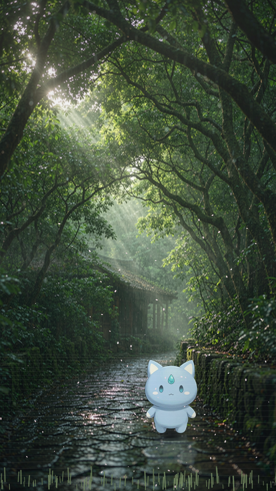
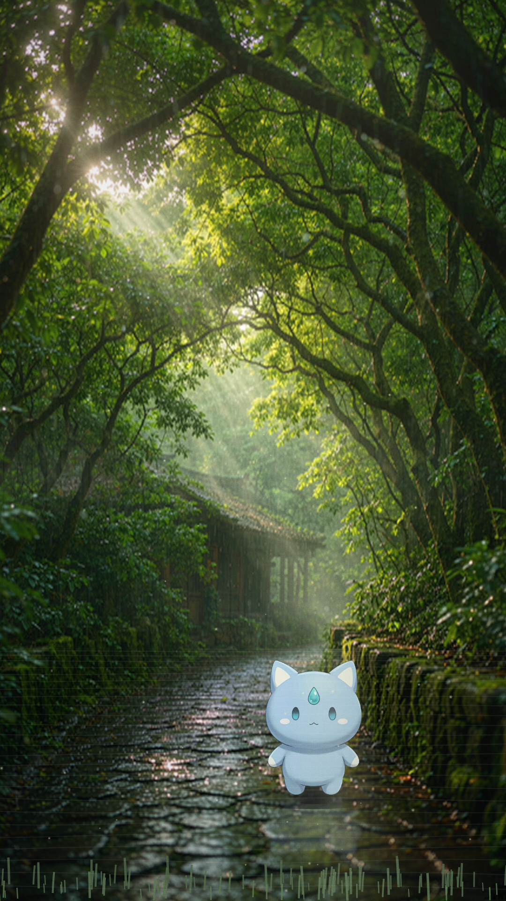
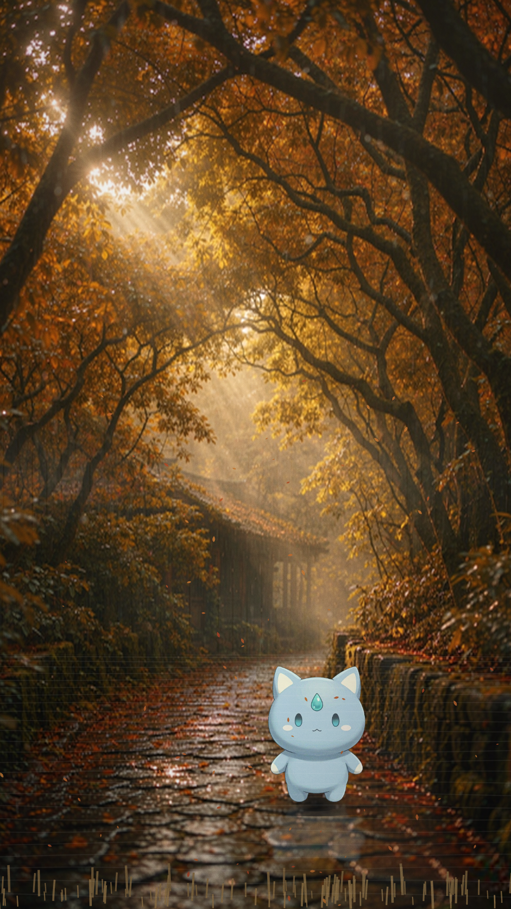
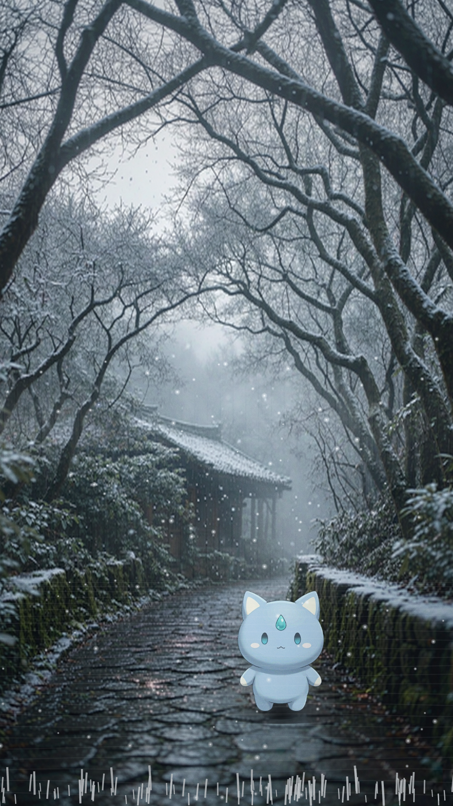
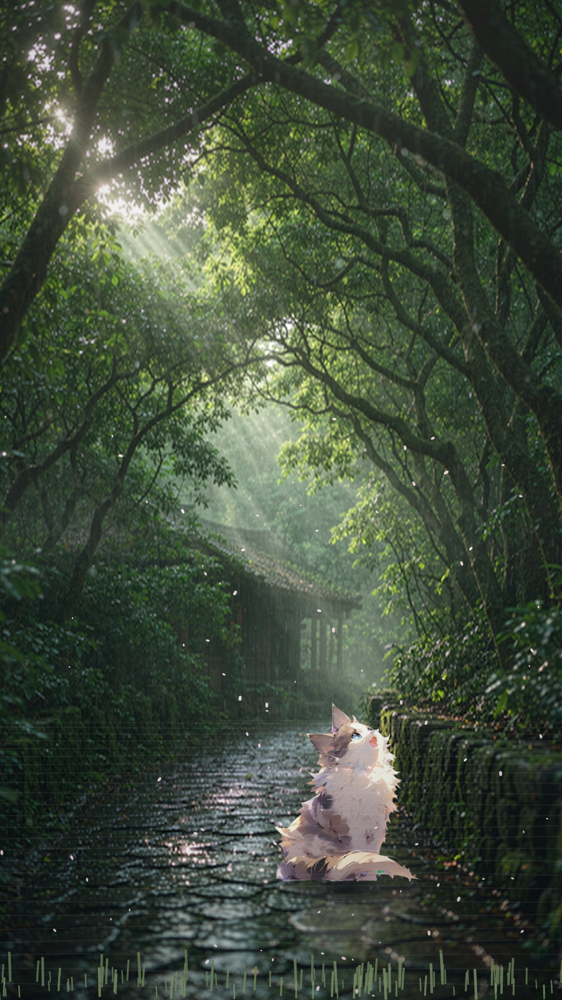

# 四季动态壁纸 · 雨后林径

> 同一座雨后森林小径，四季各一版。画面里住着两位可互动的二次元萌宠，
> 会自己散步、坐下、睡觉、舔毛，也会看向你的鼠标、被你摸头、被你投喂。

| 春 | 夏 | 秋 | 冬 |
|---|---|---|---|
|  |  |  |  |

---

## 成品

### 竖版 9:16（手机）

| 蓝猫宝 | 毛茸茸 |
|---|---|
|  |  |

`out/wallpaper/`（蓝猫宝）、`out/wallpaper-fluffy/`（毛茸茸），每组 4 张 1080×1920。

### 横版 16:9（电脑）

`out/wallpaper-16x9/`（蓝猫宝）、`out/wallpaper-16x9-fluffy/`（毛茸茸），每组 4 张 1920×1080。

> 竖版与横版使用**各自独立的母版图**，不是简单裁切 —— 两种比例下的构图都成立。

---

## 互动玩法

宠物在壁纸画面内活动，不是独立的桌面窗口。

| 操作 | 效果 |
|---|---|
| 鼠标靠近 | 宠物抬头看向光标，耳朵转向 |
| 左键点击宠物 | 被抚摸 → 眯眼享受，冒爱心，呼噜声气泡 |
| 按住拖动 | 持续抚摸，好感度上升 |
| 右键点击 | 投喂猫粮 → 宠物走过去吃光 |
| 「投喂猫粮」按钮 | 在脚边随机丢一碟猫粮 |
| 「呼唤它」按钮 | 宠物回应一声 |
| 长时间不理它 | 会自己找地方坐下、打盹、舔毛 |

### 自主行为

不需要任何操作，宠物自己就有生活：

`待机` → `散步` → `坐下休息` → `舔毛自洁` → `打盹睡觉` → `饿了讨食`

- 饥饿度随时间上升，超过阈值会走到你脚边喵喵叫
- 精力随休息恢复，睡饱了自己醒来
- 被摸和被喂会增加好感度，行为更黏人

---

## 在线运行

```bash
cd wallpaper-studio
python -m http.server 8080
# 浏览器打开 http://localhost:8080
```

### 键盘快捷键

| 按键 | 功能 |
|---|---|
| `1` `2` `3` `4` | 切换 春 / 夏 / 秋 / 冬 |
| `H` | 折叠 / 展开控制面板 |
| `F` | 全屏 |
| `W` | 壁纸模式（隐藏全部 UI） |
| `G` | 显示 / 隐藏图标安全区参考线 |

---

## 控制面板

- **季节**：春 / 夏 / 秋 / 冬，可开启自动轮播
- **画风**：治愈写实 / 新海诚 / 宫崎骏 / 水墨国风 / 极简写实
- **光照与氛围**：阳光角度 0–360°、雾气浓度、风力强弱、飘落速度
- **画面**：比例（16:9 / 9:16 / 21:9 / 1:1 / 4:3）、循环时长、镜头呼吸幅度、图标安全区
- **宠物**：显示开关、切换蓝猫宝 / 毛茸茸、投喂、呼唤

---

## 图标安全区

桌面壁纸需要在上方和中部放图标，因此：

- 上方与中部被标记为安全区，飘落粒子、雾气核心不会进入
- 按 `G` 显示参考线
- 每张母版图在生成时即被要求「天空完全空旷无物体」

---

## 重新出图

```bash
npm install

# 竖版 1080×1920（蓝猫宝 / 毛茸茸）
node tools/make-wallpapers.mjs 1080 1920 forest-rain blue    wallpaper
node tools/make-wallpapers.mjs 1080 1920 forest-rain fluffy  wallpaper-fluffy

# 横版 1920×1080
node tools/make-wallpapers.mjs 1920 1080 forest-rain blue    wallpaper-16x9
node tools/make-wallpapers.mjs 1920 1080 forest-rain fluffy  wallpaper-16x9-fluffy
```

### 动态视频导出

```bash
node tools/render.mjs --scene forest-rain-l --season autumn --style real \
  --aspect 16:9 --width 1920 --height 1080 --fps 30 --seconds 12 \
  --out out/forest-rain-autumn.mp4
```

无头浏览器按固定相位步进逐帧抓图，ffmpeg 编码。所有动效都是循环相位 `phase∈[0,1)` 的周期函数，
首尾帧严格一致，播放器循环时无跳帧。

---

## 目录结构

```
wallpaper-studio/
├── index.html              # 应用入口
├── css/app.css             # 界面样式
├── js/
│   ├── util.js             # 噪声 / 随机 / 颜色 / 调色板与画风定义
│   ├── assets.js           # 素材清单、场景元数据、宠物类型
│   ├── pet.js              # 宠物状态机 + 自主行为 + 交互响应
│   ├── scene.js            # 渲染引擎：底图 + 动态图层 + 后期
│   └── app.js              # 控制面板、循环播放、鼠标交互
├── assets/
│   ├── scenes/
│   │   ├── forest-rain/    # 竖版母版（春夏秋冬）
│   │   └── forest-rain-l/  # 横版母版（春夏秋冬）
│   └── pet/                # 两种宠物 × 三姿态（idle/walk/happy）
├── tools/
│   ├── make-wallpapers.mjs # 四季成品出图
│   ├── render.mjs          # 无头离线视频渲染
│   ├── batch.mjs           # 批量任务
│   ├── preview.mjs         # 静帧预览
│   └── chromakey.py        # 绿幕抠像（宠物素材）
└── out/                    # 成品输出
```

---

## 技术要点

**几何恒定**：四季母版由同一张参考图经图生图派生，山脊轮廓、屋顶位置、树枝结构在四季之间完全一致。

**无缝循环**：所有环境动效（雾气漂移、光束、飘落物、镜头呼吸）都是 `sin(2π·k·phase)` 形式的整数倍谐波，
第 0 帧与第 1 帧严格一致。宠物使用独立时间轴（真实行为不该被循环约束），不影响壁纸的循环数学。

**宠物光影融合**：宠物会被乘上季节环境色 + 太阳色，逆光场景加轮廓光，湿地面场景加倒影，
脚下有接触点暗影与柔和投影，因此看起来是站在画面里而不是贴上去的。

**绿幕抠像**：`tools/chromakey.py` 用「归一化绿度 + 边界连通扩散」判定绿幕，
从四边做 flood fill，只抠与画面边界连通的绿色 —— 猫身上的绿色反光不会被误抠。
